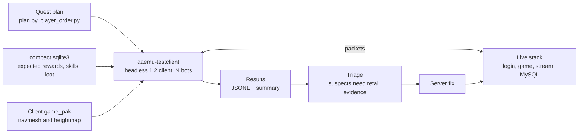

# Bots

- Audience: Contributors and testers
- Last verified against: `rust-rewrite-bots` on October 20, 2026
- Target: ArcheAge 1.2 (`r208022`)

## Overview

Most of the bots are copies of one headless 1.2 client, `aaemu-testclient`. Each copy logs in to the
servers the same way a real player does. The bots play scripted scenarios and run long sweeps
over quests, crafts, skills and NPC AI. They then compare what the server did with
`compact.sqlite3` and report mismatches. The game server also has the phase 0 connectionless
`/bot` operator commands (no client socket); their status is in [Player Bots](Player-Bots). A
second headless driver, the AABevy client's
script runner, verifies client features through the real UI (see
[The AABevy headless script runner](#the-aabevy-headless-script-runner)).



## The headless test client

`aaemu-testclient` (`rust/crates/aaemu-testclient`, about 40k lines) speaks the real login, game
and stream protocols. The server cannot tell it apart from a player.

How a bot connects:

1. **Login** (`login.rs`). The bot sends `CARequestAuthTrion` carrying the launcher's XML ticket.
   The ticket's password field is the lower-case hex SHA-256 of the plain password. The bot then
   lists the worlds and gets a world cookie with `CAEnterWorld`.
1. **Game** (`game.rs`, `scenario.rs`). The bot sends `X2EnterWorld` with the cookie and
   `FinishState` 0 to 7. It then lists the characters, creates one if the account has none (a
   Nuian fighter by default), selects it and spawns.
1. **Stream** (`stream.rs`). The bot sends `CTJoin` with the token from `X2EnterWorldResponse`.
1. **Leave**. The bot sends `CSLeaveWorld` and waits 10 s for `SCLeaveWorldGranted`.

The client runs entirely async on tokio, with no OS threads. A reader task feeds frames into a
channel, and the bot logic handles one step at a time. Every 3 s the bot sends a ping, because
the server drops a session after 30 s without one. `Recorder` captures every frame as JSONL for
parity diffs.

| Module | Role |
| --- | --- |
| `main.rs` | Flag parser and subcommand dispatch |
| `login.rs`, `game.rs`, `stream.rs` | Protocol clients. `game.rs` has a helper for every player action and `gm()` for GM commands |
| `scenario.rs`, `scenario/*.rs` | Scripted flows (`full`, `combat`, `questitem`, ...) and the `script` command language |
| `questrun.rs` | Quest audit runner |
| `player.rs`, `walk.rs`, `fight.rs` | Player mode: walks the navmesh at 5.4 m/s, fights with learned skills, loots and revives |
| `craftrun.rs`, `skillrun.rs`, `aisweep.rs` | Craft, class-skill and NPC AI sweeps |
| `valuecheck.rs` | Compares quest rewards and kill XP with `compact.sqlite3` |
| `quest.rs`, `inventory.rs`, `social.rs` | Packet codecs for quests, bags, duels, parties and loot dice |
| `compactdb.rs` | Read-only lookups in `compact.sqlite3` |
| `record.rs`, `diff.rs`, `load.rs` | Capture, parity diff and load test |

### Config file

Copy `testclient.example.json` to a git-ignored `*.local.json`. Command-line flags override its
values.

| Field | Default | Meaning |
| --- | --- | --- |
| `login` | `127.0.0.1:1237` | Login server the bot connects to; the game and stream addresses come from the world cookie. Set it to your server's client login port, which is not 1237 when the ports are remapped |
| `user`, `password`, `character` | password `testpass` | The account, and the name given to a new character |
| `game_server_id` | 1 | World to enter |
| `skill_id` | 2 | Melee skill; also the quest runner's combat skill |
| `quest_id`, `quest_npc_template` | 330, 3597 | Quest accepted in `full`, and its giver |
| `combat_npc_template` | 3492 | Fox attacked in `combat`; 0 skips that step |
| `wait_leave_granted` | true | Wait for the logout grant |
| `npc_return_distance`, `npc_return_away_secs` | 2048, 70 | Settings for the `npc-return` scenario |
| `mate_item_*`, `stablehand_*`, `revive_*` | horse 8159, stablehand 1890 | Settings for the `mate-revive` scenario |
| `quest_item_*` | quest 2394 | Settings for the `questitem` scenario |

Environment variables: `AAEMU_SCRIPT`, `AAEMU_PLANT_POS`, `AAEMU_PLANT_COUNT`, `AAEMU_GAME_PAK`,
`AAEMU_NPC_SPAWNS` and `RUST_LOG` (default `warn`).

## Subcommands

`run` plays one scripted scenario. Most of the other subcommands are sweeps that write one JSONL
line per quest, recipe, skill or NPC. A `suspect` line from a sweep is a candidate for triage,
not a confirmed bug.

| Subcommand | What it does | Output and pass rule | Reference result |
| --- | --- | --- | --- |
| `run` | Plays one `--scenario` and checks the server's answer at every step | Prints ok/FAIL per step; fails if any step failed; `--out` writes a capture | |
| `parity` | Runs a scenario against two servers and diffs the server-to-client packets | Exit 2 on any finding | `full`: 1,330 packets, 0 findings |
| `diff` | Diffs two saved captures using the `parity.json` masks | Exit 2 on any finding | |
| `load` | Runs `--bots N` bots at once on the `load` flow, started `--ramp-ms` apart | p50/p95/max latency per step; exit 2 if any bot failed | 200 of 200 bots ok |
| `quest` | Quest audit from a static plan, in GM mode or `--player` mode | One line per quest with `result`, `blocker` and `fallbacks` | Player mode: 28 of 35 quests completed |
| `craft` | Supplies the materials, labor and doodad, then crafts each recipe | `crafted` or a finding class; resumes from `--out` | 3,352 of 7,010 recipes usable |
| `skill` | Casts each of the 170 class skills on a training dummy. Checks cast time, mana, cooldown, buffs and damage | `ok`, `rejected`, `timeout`, `unsupported`, plus `mismatches` | 169 ok, 1 unsupported |
| `fight` | Player-mode combat loop with a skill scheduler, potions, loot and revive | `FightReport`; aborts after `--max-deaths` | |
| `ai` | Reproduces NPC AI suspects S1–S10 (leash, radii, alert, ranged stop, idle return, gap, spurt, burst, spawn window, attack speed) | `suspect`, `matches` or `inconclusive` per NPC | |
| `walk` | Walks to `--to` over the navmesh and heightmap; `--pak-info` works offline | JSON report | |

The client has no replay command: captures are only used by `diff`. `valuecheck` is not a
command either; the quest runner calls it.

### Scenarios for `run --scenario`

A scenario marked GM needs an account at access level 100.

| Scenario | GM | What it checks |
| --- | --- | --- |
| `login` | No | Auth, world list and cookie only |
| `lobby` | No | Login, lobby, stream join and character creation |
| `full` | No | Select, spawn, move, chat, a skill on an NPC, a bag swap, accepting quest 330, leaving |
| `combat` | No | `full`, plus three hits on a fox that fights back |
| `load` | No | The short flow that `load` uses |
| `npc-return` | No | After the bot leaves past the retention window and comes back, the quest giver is the same instance |
| `mate-revive` | Yes | The stablehand revives a dead mount, and it can be re-summoned alive |
| `questitem` | Yes | Quest 2394: using the Detection Orb on NPCs 7824/7823 counts 3 |
| `doodad` | Yes | Quest 3447: using the Amber Boulder counts 1, on the original and on a spawned copy |
| `plant` | Yes | Crops, trees and baby animals can be placed from seeds |
| `stonethrow` | Yes | Skill 11268 unlocks the stack correctly |
| `ghost` | Yes | A killed ghost respawns exactly once within 130 s |
| `portal` | Yes | Saving and deleting a portal book entry, the Memory Tome districts, and the gate distance check |
| `script` | Yes | Runs the command file named in `$AAEMU_SCRIPT` |

The `script` language takes one command per line and allows `#` comments. Its commands cover:

- GM and world actions: `gm`, `tp`, `kill`, `cast`
- Quests: `sq`, `cq`
- Bag and items: `item`, `equip`, `split`, `sell`
- Trade: `tstart` to `tok`
- Portals, auction and mail, party, labor and repair
- `loaded`: answers `SCLoadInstancePacket` with `CSInstanceLoadedPacket` (needed before a doodad spawned in a new instance is visible)
- Raw packets: `rawcs`
- Waiting for social events: `await`

Two-bot duels, trades and parties run as one process per bot, each with its own script.

### Quest runner

- **Plan.** `rust/tools/quest_audit/plan.py` builds a step plan for each quest from
  `compact.sqlite3` and the spawn data. `player_order.py` puts the quests in story order for
  player mode. See [Quest Technical Audit](Quest-Audit).
- **GM mode.** The runner turns on godmode, raises the level with `/level` for each quest and
  runs the quests in prerequisite order.
  - Items and NPCs come from their real sources first. `/item add` and `/spawn` are fallbacks,
    and every use is logged.
  - `--force-blocked` lets a GM command complete a quest, but only as a last resort.
- **Player mode** (`--player`). The bot walks the client's `.bai` navmesh, fights with the skills
  it has learned, loots and revives.
  - It never uses `/godmode`, `/level` or `/kill`.
  - It stops at the first story quest it cannot finish.
  - It can `--resume` from a checkpoint.
- **Value checks.** For each completed quest, the runner compares XP, gold, items, kill XP and
  loot with `compact.sqlite3`. A mismatch is logged as a labelled suspect.
- **Results.** Each quest line ends in a result such as `completed`, `failed`, `stuck`, `rejected`,
  `prereq_missing`, `requirement_unmet`, `blocked_plan` or `runner_unsupported`. Each blocker has
  a class: `runner_gap`, `suspect`, `data_gap` or `requirement`.

## Live verification suites

`Scripts/verify.sh` turns a fix into one command that can be rerun: it starts the lane stack,
provisions the suite's bot accounts (including GM access) and runs every `rust/verify/*.vtest`
suite. A suite declares several named bots whose script sections run concurrently and
synchronise with `waitpeer`/`sync`; assertions cover server packets (`expectpkt`,
`expectnopkt`), game-server log lines (`expectlog`) and game-database values (`expectdb`).

```sh
Scripts/verify.sh                    # all suites, PASS/FAIL + report
Scripts/verify.sh --only guild       # one fix's suite while working
```

The format, the expectation commands, the report location and how to add a suite are in
[Live Verification Suites](Verification). Run it before `lane.sh check`.

## The AABevy headless script runner

The AABevy client (`aa-client.exe`, a separate repository) has a headless mode that runs a command file
against a live stack and exits 0 for PASS:

```sh
aa-client.exe --headless --account NAME --login HOST:PORT --password-file P --script run.txt               [--character C] [--offscreen-shot out.png]
```

- It drives the real UI Lua, not a protocol stub, so it checks a client feature end to end: the
  server packets, the client's state and what the original windows show. It was used to verify
  titles.
- Commands include `gm`, `lua`, `expect`, `await`, `waitfor` and `shot`. The command reference is
  `docs/aa-client-script.md` in the client repository, on `main` since pull request
  NickMesser/AABevy1.2#2 merged (2026-10-20).
- Gotcha: `await` matches events that are already queued. After an action whose event may have fired
  already, use `waitfor N lua <condition>` instead.

## Accounts

- `AutoAccount` on the login server creates an account the first time it logs in. That first
  login also sets the account's password; later logins must use the same one.
- The bot sends the password from its config or `--password`, and `testpass` when neither sets
  one. Some scripts use the account name as the password, but that is a script choice, not a
  rule.
- Default account names:
  - `clienttest`: the real 1.2 client
  - `multitest_a` and `multitest_b`: the multiplayer smoke test
  - `bevytest`: the AABevy client
  - `bot1`: the example config
- GM scenarios and sweeps need access level 100. The account id is printed in the `login.auth`
  step. Run this against the test MySQL only, never against a database that holds real data:

  ```sql
  UPDATE <game_db>.accounts SET access_level=100 WHERE account_id=<id>;
  ```

- An account can hold 6 characters. After several `--new-character` runs, switch to a fresh
  account.
- The AABevy client remembers the last account. With `--account` it logs in automatically; without it
  the login form is prefilled from the saved config (default `bevytest`). With `AutoAccount` a
  mistyped or stale name silently creates a new, empty account, and the client lands on the character
  creation screen.
- The AABevy client takes its password from `--password-file`, else `$AA_PASSWORD_FILE`, else
  `D:aemu-live\cfg\client-test-password.txt`, else the account name
  (`crates/aa-client/src/ingame/enter.rs` in the client repository).
- Keep passwords in git-ignored files (`--password-file`) and out of command lines.

## Running the bots

1. Start a login and game server that use a test MySQL (see [Local Development
   Guide](Local-Development-Guide)).
1. Write a `testclient.local.json` with `login`, `user`, `password` and `character`.
1. Grant GM access to the account if you need it (see [Accounts](#accounts)).
1. Run a subcommand (`TC` = the built `aaemu-testclient` binary):

```sh
TC run   --config testclient.local.json --scenario full --out run.jsonl
TC load  --config testclient.local.json --bots 50 --prefix load --ramp-ms 20
TC quest --config testclient.local.json --plan plan.json --all-ok --race elf --compact-db <compact.sqlite3> --summary
TC quest --config testclient.local.json --player --new-character --race nuian --plan nuian-order.json \
         --compact-db <compact.sqlite3> --to-level 15 --out nuian-run.jsonl --state nuian.state.json --summary-file summary.md
TC craft --config testclient.local.json --compact-db <compact.sqlite3> --sample 40 --out craft-audit.jsonl --summary
TC skill --config testclient.local.json --compact-db <compact.sqlite3> --new-character --all --out skill-audit.jsonl --summary
TC ai    --config testclient.local.json --all --compact-db <compact.sqlite3> --out ai.jsonl --summary
```

A `quest` run needs a plan, which you build first:
`python rust/tools/quest_audit/plan.py --db <compact.sqlite3> --worlds <app>/Data/Worlds --output plan.json`.

To see the server's side of a run, start the game server with:
`RUST_LOG=info,aaemu_game::systems::skills::plots=debug,aaemu_game::systems::npcs=debug`

`craft` and `skill` can resume: an existing `--out` file makes them skip the ids it already
holds. Four bots running in parallel can cover the four races in one quest sweep.

The full reference is `rust/LIVE-TESTING.md` §3–§5.

## Server side

The game server has no AI-driven fake players, PvP bots or quest-running bots. It does have the
phase 0 connectionless `/bot` operator commands (`systems/bots/`: add / remove / list / walk /
cast); their status and limits are in [Player Bots](Player-Bots). The bot-related server code is:

- **ReportBot**, the retail feature that lets players report suspected bots:
  `systems/social/crime.rs` (a "prime suspect" buff past a threshold) and the `ReportBot` skill
  effect.
- **Movement validation**: `systems/ai/collision/move_verify.rs` (`Physics.MoveVerify*`, on by
  default) bounds player / mount / vehicle speed over a time window, whitelists server
  teleports and corrects a client-side teleport; `systems/services/sus.rs` still writes the
  over-25-m/s audit rows and counts the guard refusals. In-server `/bot` characters are exempt.
  A walking bot must still avoid obstacles itself (the guard does not collide).
- **What the bots rely on**:
  - GM commands: `/item add`, `/spawn npc`, `/spawn doodad`, `/move`, `/setfaction` and godmode.
  - The `Account.PremiumForAll` test switch.

Server fixes found by the bots so far:

- Quest fixes
- NPC AI alert, leash, hold position and spurt
- Duel and battlefield factions
- A duel ends when a participant leaves
- Duel countdown
- An emote guard
- Plot-skill `ManaCost` now uses the tooltip formula

## Known gaps

Server findings from the bots are tracked in [Server Backlog](Server-Backlog#found-by-the-bots).
The gaps below are in the bots and their tooling.

| Finding | Seen in | Size | Likely cause |
| --- | --- | --- | --- |
| `/item add` created nothing | Quest sweep | 301 | The bot's bag was full |
| `run --new-character --race firran` fails ("created character … is not in the list"), and `run` ignores `--race` | Instance-exit and PvP checks | Tool | Only the sweeps honour `--race` |
| The `full` scenario passes even when a step fails, and its parity target is the removed C# server | Retail parity audit | Tool | Bot weakness |
| Passwords leak through the tooling (argv, an echoing prompt, hashes in captures) | Retail parity audit | Tool | Security |

The player-mode run reached level 7 with 28 deaths in 84 minutes, so the fight logic still needs
work.

Next steps:

1. Rerun the four-race quest sweep and write a summary file for each run: the instance-exit fixes
   (`ae5c73933`, `00ba92067`) and the testclient `loaded` command (`9d9886c60`, upstream PR
   NickMesser/AAEmu#20) are merged (see [Server Backlog](Server-Backlog#found-by-the-bots)).
1. Run a sample of the 622 needs-review quests live; the static audit does not certify that
   they can be played.
1. Build a tooltip-oracle bot that reads the 1.2 client's tooltip numbers through
   `aaemu-clientdriver`.
1. Add bots inside the server, then the custom game modes.

## Related

- [Server Backlog](Server-Backlog)
- [Quest Technical Audit](Quest-Audit)
- [Local Development Guide](Local-Development-Guide)
- [Developer Notes](Developer-Notes)
